<p align="center">
  
</p>

<h1 align="center">Songstress Extensions</h1>

<p align="center">
  <b>More music. Your colours. Your code.</b><br />
  The official extensions for <a href="https://songstress.app">Songstress</a>: more places to find music, and thirteen themes.<br />
  Nothing here is built in. Your server installs what you choose, and you can build your own.
</p>

<p align="center">
  <a href="https://github.com/pacholoamit/songstress-extensions/actions/workflows/ports.yml"></a>
  <a href="#music-sources"></a>
  <a href="#themes"></a>
  <a href="sdk/README.md"></a>
</p>

<p align="center">
  <a href="https://songstress.app">songstress.app</a> &nbsp;•&nbsp;
  <a href="#install-an-extension">Install</a> &nbsp;•&nbsp;
  <a href="#music-sources">Music sources</a> &nbsp;•&nbsp;
  <a href="#themes">Themes</a> &nbsp;•&nbsp;
  <a href="#build-your-own">Build your own</a> &nbsp;•&nbsp;
  <a href="#working-in-this-repository">Contribute</a>
</p>

<br />

<p align="center">
  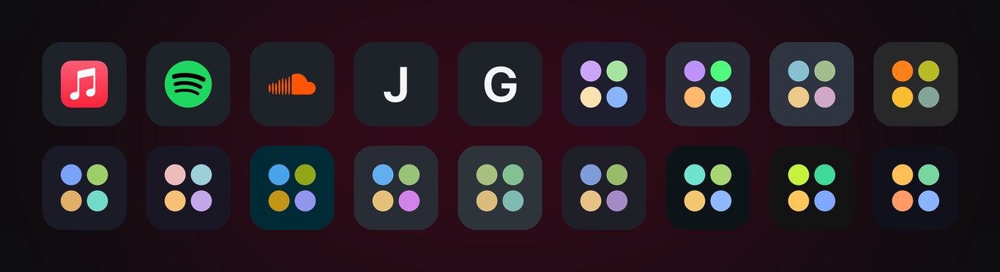
</p>

> [!NOTE]
> **Coming with Songstress's extensions release.** Extensions, the Marketplace on songstress.app, and the `songstress` SDK on npm all arrive together. Until then you can build and test inside this repository, where `sdk/` holds the SDK.

## Install an extension

1. In Songstress, open **Manage ▸ Extensions**. Only admins see it.
2. Choose **Browse extensions**, pick one, and choose **Install**.
3. Songstress shows everything it asks to do. Tick what it may do, then turn it on. Nothing runs before you've seen it.

**Rather use a link?** Choose **Add an extension**, paste `github.com/pacholoamit/songstress-extensions`, and pick the one you want. A `.songstress` file from a release works too.

**Themes** are installed the same way. Once an admin installs one, everyone on the server can choose it in **Settings ▸ Appearance**.

## Music sources

Each one adds a catalogue to Search and opens its links. Songstress's own sources keep working beside them.

| | Extension | What it adds | Licence |
|:-:|---|---|---|
|  | **Apple Music**<br /><sub>`songstress.apple-music`</sub> | Search Apple Music beside iTunes, and open its songs, albums, playlists and artists from a link. Adds each song's ISRC, and synced lyrics with your own Media User Token. | LGPL-3.0 |
|  | **Spotify Web**<br /><sub>`songstress.spotify-web`</sub> | Search Spotify's web catalogue beside Songstress's Spotify, and open its links, `spotify:` ones too. Fills in each track's ISRC and Deezer id. | LGPL-3.0 |
|  | **SoundCloud**<br /><sub>`songstress.soundcloud`</sub> | Search tracks, sets and artists, and open them from a link. It can stream a track to try it and acquire its AAC stream, both off until an admin turns them on. | LGPL-3.0 |
|  | **JioSaavn**<br /><sub>`songstress.jiosaavn`</sub> | Search songs, albums, playlists and artists in the languages you choose, and open them from a link. It can stream a song to try it and acquire it in five AAC qualities, both off until an admin turns them on. | LGPL-3.0 |
|  | **Genie Music**<br /><sub>`songstress.genie-music`</sub> | Search Genie Music's songs, albums and artists, and open them from a link. | MIT |

The four LGPL-3.0 sources are ports from Songstress's earlier extension system; each folder's `NOTICE` names their original authors. Genie Music was written anew from Genie's own pages.

**Bugs Music and Melon Music aren't here.** Their earlier versions publish no licence, so they couldn't be ported. Bugs answers bots with a challenge, and Melon's site doesn't answer outside Korea, so neither could be written and checked yet.

## Themes

A theme recolours all of Songstress, the player included. Every look passes the readability rules the apps hold themselves to: words at 4.5:1 or better on every surface, over any album cover. Songstress's logo, Wrapped and share cards always stay its own.

Each picture is Songstress's Home with the theme installed, its looks side by side from left to right.

**From palettes you know**

<table>
  <tr>
    <td width="50%" valign="top">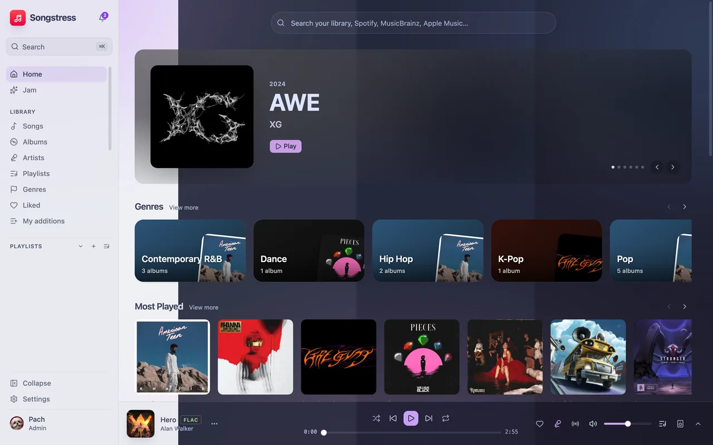<br /> <b>Catppuccin</b><br /><sub>Latte, Frappé, Macchiato and Mocha</sub></td>
    <td width="50%" valign="top">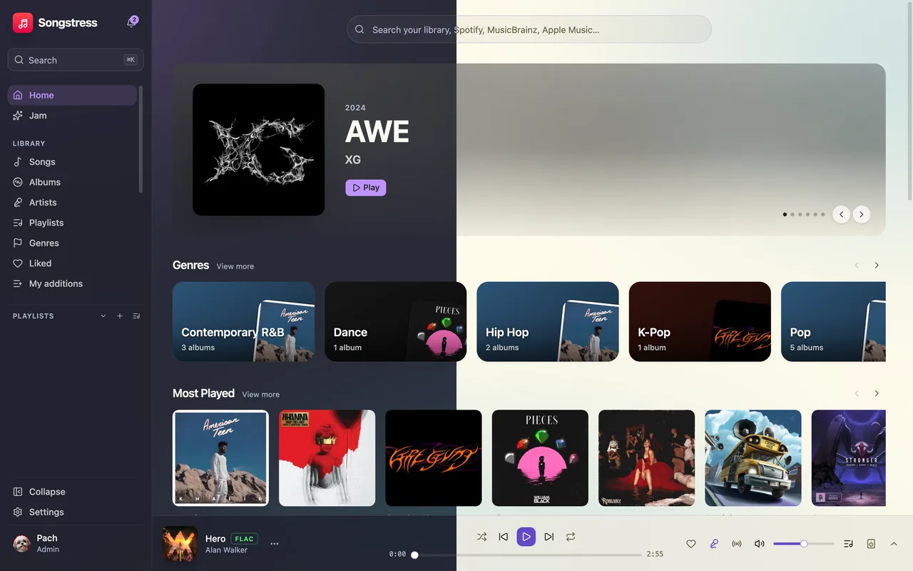<br /> <b>Dracula</b><br /><sub>Dracula, and Alucard for light</sub></td>
  </tr>
  <tr>
    <td width="50%" valign="top">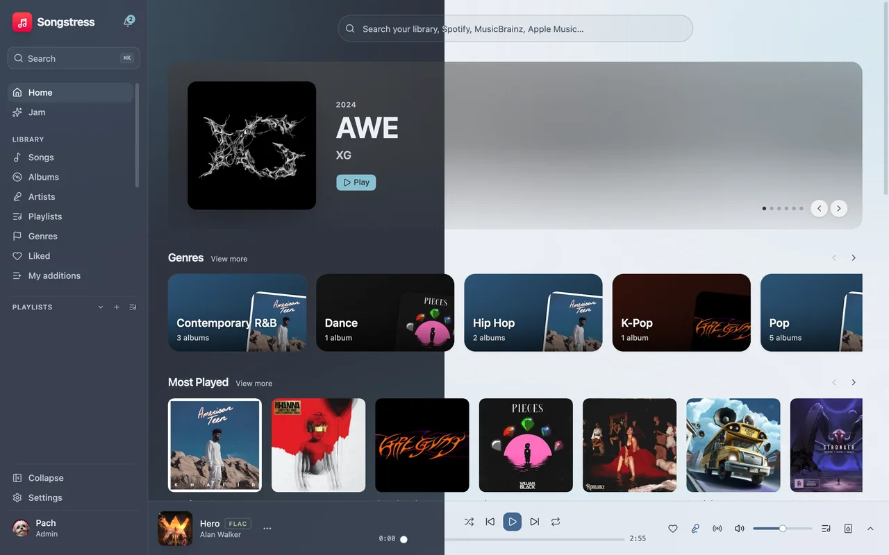<br /> <b>Nord</b><br /><sub>Polar Night, and Snow Storm for light</sub></td>
    <td width="50%" valign="top">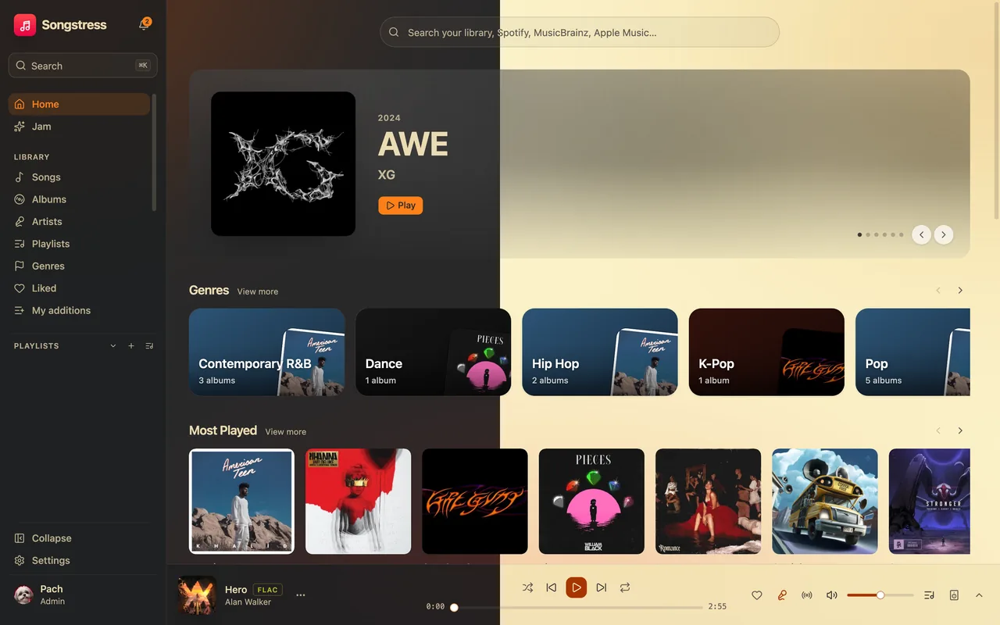<br /> <b>Gruvbox</b><br /><sub>Dark and light</sub></td>
  </tr>
  <tr>
    <td width="50%" valign="top">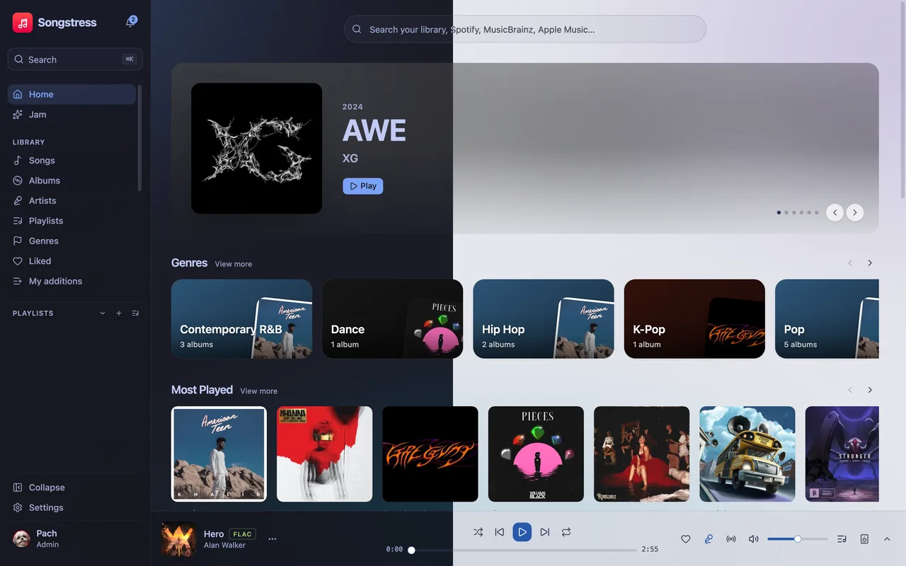<br /> <b>Tokyo Night</b><br /><sub>Night, and Light for the day</sub></td>
    <td width="50%" valign="top">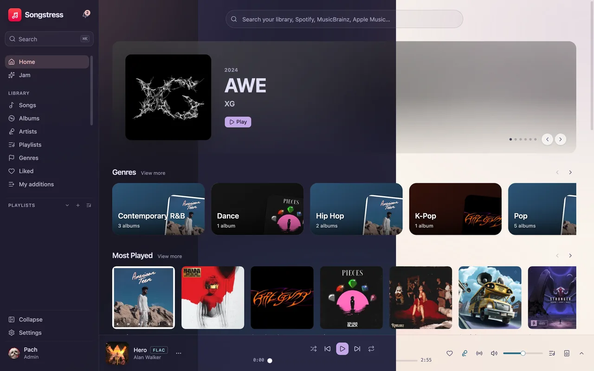<br /> <b>Rosé Pine</b><br /><sub>Main and Moon, and Dawn for light</sub></td>
  </tr>
  <tr>
    <td width="50%" valign="top">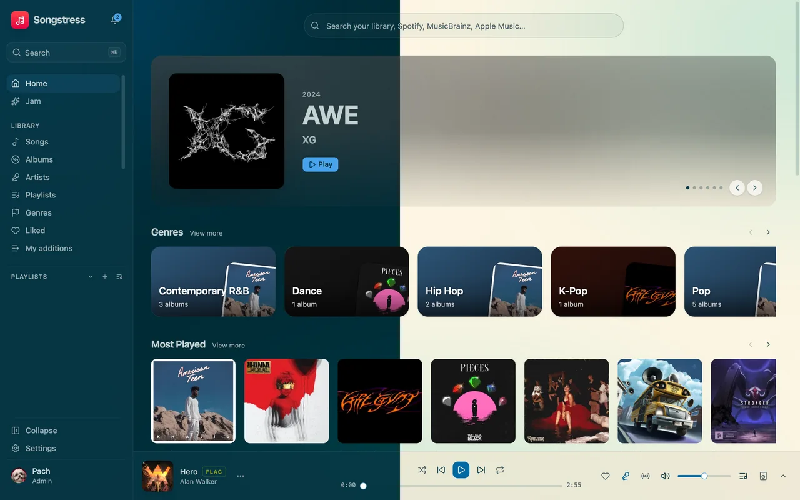<br /> <b>Solarized</b><br /><sub>Dark and light</sub></td>
    <td width="50%" valign="top">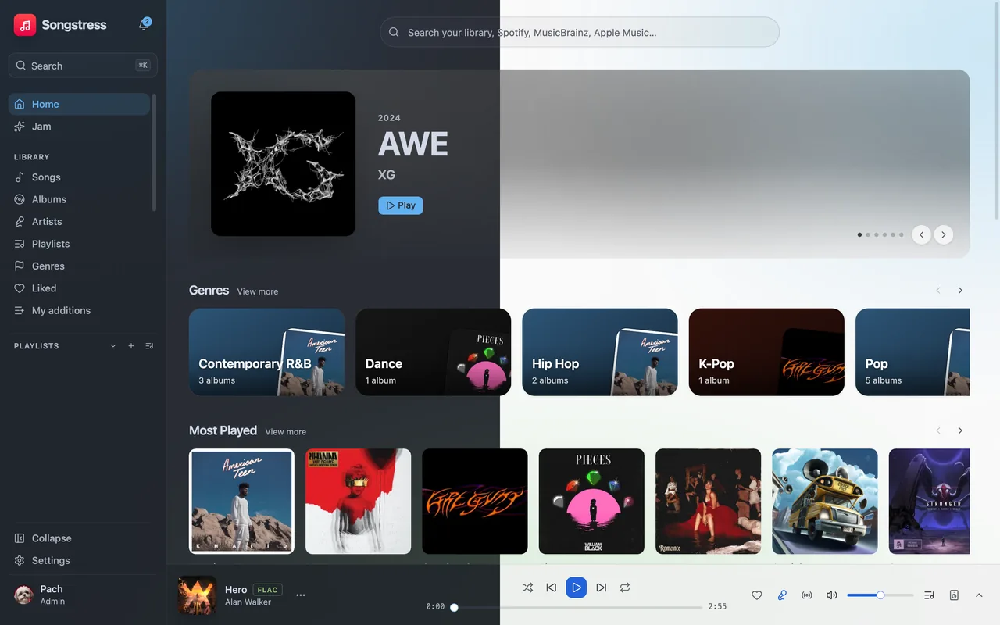<br /> <b>One</b><br /><sub>One Dark and One Light</sub></td>
  </tr>
  <tr>
    <td width="50%" valign="top">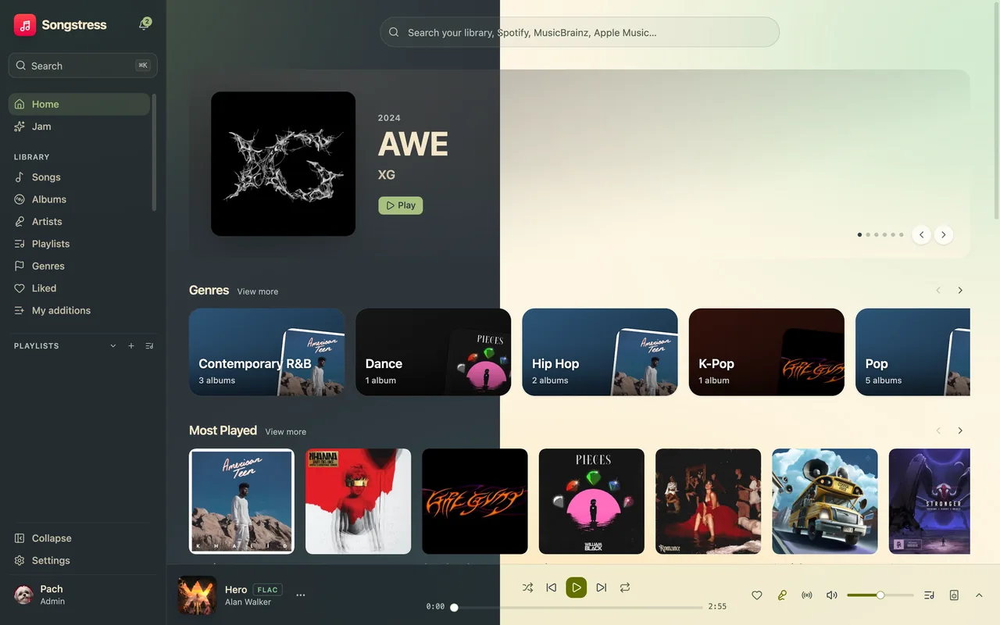<br /> <b>Everforest</b><br /><sub>Dark and light</sub></td>
    <td width="50%" valign="top">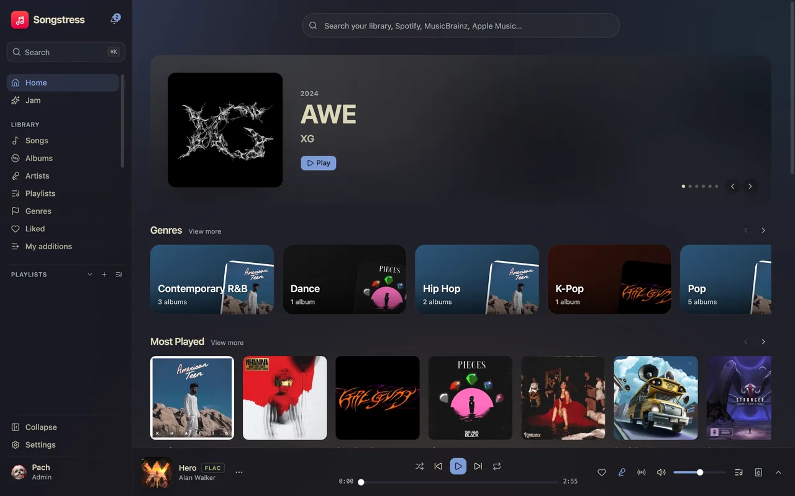<br /> <b>Kanagawa</b><br /><sub>Wave, dark only</sub></td>
  </tr>
</table>

**Made for Songstress**

<table>
  <tr>
    <td width="50%" valign="top">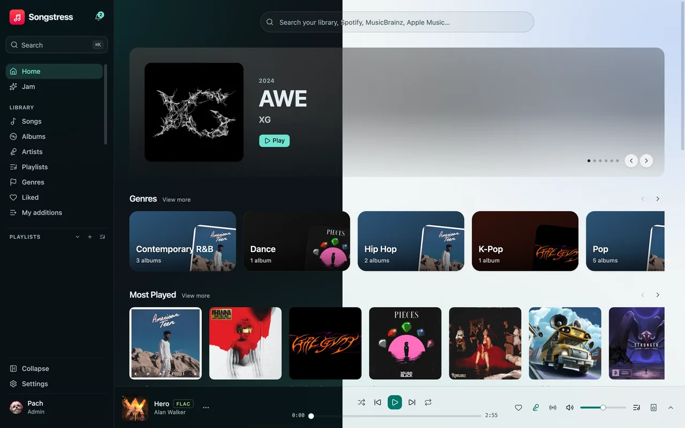<br /> <b>Glacier</b><br /><sub>Ice mint on smoky blue-black, and frost for the day</sub></td>
    <td width="50%" valign="top">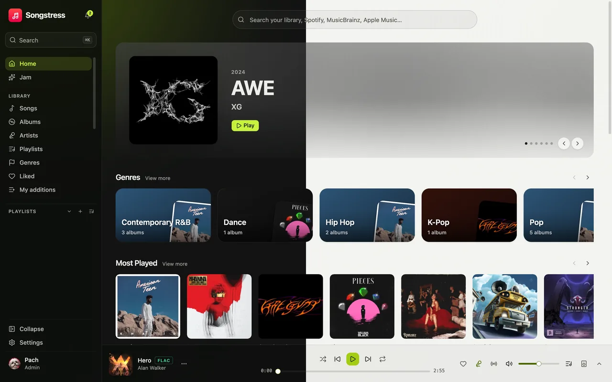<br /> <b>Studio</b><br /><sub>Graphite with one lime signal light, dark and light</sub></td>
  </tr>
  <tr>
    <td width="50%" valign="top">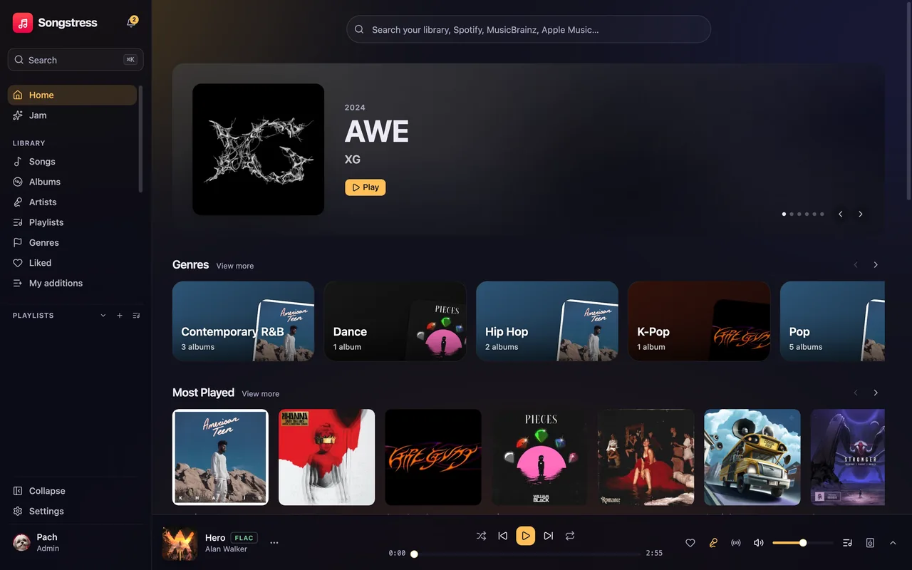<br /> <b>Nocturne</b><br /><sub>Deep indigo lit in saffron, dark only</sub></td>
  </tr>
</table>

Each theme's README lists any colour moved off its palette so that it reads where the apps draw it, and why.

## Build your own

An extension is a folder with a manifest, `songstress.json`, and the code or colours it names. You keep yours in your own GitHub repository and never need to add it here.

### From idea to listed, in five steps

**1. Start it**

```sh
npm create songstress-extension@latest
```

It asks for a name, an id (`your-github-name.my-extension`) and a category, then writes a working extension: a manifest that passes its check, a typed entry, tests, and the workflows that check and release it. To start a theme instead, add `-- --theme`: a dark and a light look, with nothing to build.

**2. Run it on your own server, live**

```sh
cd my-extension
export SONGSTRESS_SERVER=http://music.local:8090   # your Songstress server
export SONGSTRESS_EMAIL=you@example.com            # an admin of it
export SONGSTRESS_PASSWORD=...                     # or SONGSTRESS_TOKEN, an admin's session
npx songstress dev
```

`dev` builds your extension and installs it on your server as a development install that only you can see. Every time you save, it installs it again. Its log streams to your terminal.

**3. Test it without a server**

```sh
npm test
```

Your tests run against `songstress/testing`, a stand-in Songstress: fire a hook, run a command, call a provider, and see every call your code made. The [SDK's guide](sdk/README.md#test-it) has an example.

**4. Check it and release it**

```sh
npx songstress check                     # what a server checks when it installs it
npx songstress check --profile listing   # what the Marketplace asks on top
git tag v0.1.0 && git push --tags        # the release workflow attaches <id>-0.1.0.songstress
```

Anyone can now install it from your repository's link.

**5. List it**

Submit your repository at [songstress.app/extensions/submit](https://songstress.app/extensions/submit). A person reviews it, then it's listed in the Marketplace.

### What an extension can add

| | |
|---|---|
| **Music providers** | Search, lookups and links, lyrics, artwork, metadata, scrobbling, recommendations, playback and downloads. Each one joins Songstress's own and never replaces it. |
| **Hooks** | React to what happens, like a song starting (`onPlay`) or a play counting (`onScrobble`). |
| **Commands and settings** | Buttons and settings that Songstress draws for you. |
| **Screens** | Pages, panels, menu entries, status items in the player, questions and notices. You declare them, and every Songstress app draws them natively. |
| **Client code** | Code that runs inside the apps, in a sandbox. |
| **Themes** | Colours for all of Songstress, as data, with no code at all. |

### Safe by design

- Server code runs in your server's extension host, in a sandbox: the JavaScript language, timers, `console.log` and the `songstress` API, and nothing else. There's no Node and no `fetch`.
- It reaches the network only through `songstress.net.fetch`, and only to the hosts its manifest names.
- Every permission carries the reason you wrote for it, and an admin sees each one before anything runs.
- Hold your compiler to the same rules: with `"types": ["songstress/sandbox"]` in `tsconfig.json`, `fetch`, `process` and the DOM don't compile.

### The `songstress` command

| Command | What it does |
|---|---|
| `songstress check` | Checks every manifest in the folder as a server does when it installs one, holds each theme to the readability rules, and names its release |
| `songstress build` | Builds each entry under `src/` into one script under `dist/` |
| `songstress pack` | Builds, then writes the package a release carries, `<id>-<version>.songstress` |
| `songstress dev` | Installs it on your own server for you alone, again on every save, and streams its log |

### Learn more

- [The SDK's guide](sdk/README.md): the API, the stand-in Songstress for tests, and the command.
- [The specification](sdk/SPEC.md): the manifest field by field, hooks, permissions, the API, screens, providers, themes and listing.
- Small extensions to read: [`extensions/genie-music/`](extensions/genie-music) for a music source, [`extensions/glacier/`](extensions/glacier) for a theme, and [`sdk/examples/tunelog/`](sdk/examples/tunelog).
- Questions and problems: [issues](https://github.com/pacholoamit/songstress-extensions/issues).

## Working in this repository

This is for changes to the official extensions. You need Node 24.3 or later and pnpm 9 (`corepack enable` gives you pnpm).

```sh
git clone https://github.com/pacholoamit/songstress-extensions.git
cd songstress-extensions
pnpm install
pnpm verify          # types, lint, tests and every manifest's check: exactly what CI runs
```

To work on one against your own server:

```sh
cp .env.example .env             # your server, and an admin's email and password (or a session token)
pnpm dev extensions/soundcloud   # builds it, installs it for you alone, again on every save
```

To pack one exactly as its release would: `pnpm exec songstress pack extensions/soundcloud`.

**A new official theme:** copy a theme's folder (`extensions/glacier/` is a good start), give it a new id and name in `songstress.json`, and change the colours in `themes/`. Colours can be hex, `rgb()` or `hsl()`. `pnpm check` names any pair that doesn't read, and `pnpm dev extensions/<name>` shows it on your server as you go.

### What's where

| Path | What it is |
|---|---|
| `extensions/<name>/` | One extension: its `songstress.json`, its code in `src/` or its looks in `themes/`, `assets/icon.png`, its README and its licence files |
| `extensions/shared/` | Code the music sources share (requests, matching songs, kept values), built into each one's package |
| `sdk/` | The Songstress extension SDK, carried here until it's on npm |
| `theme/` | The theme engine the apps use. `check` holds every look to it |
| `index/` | Builds and signs the official index |

### Tests

- Each music source's `server.test.ts` runs its providers against a stand-in Songstress and a stand-in service (`extensions/shared/testing.ts`).
- `official.test.ts` checks that every manifest is Songstress's own, passes the install checks, would pass the listing checks once it has its images, and packs the same package every time.
- `index/*.test.ts` covers the signed index, `publishers.json` as a server reads it, the releases it lists, and the ping to songstress.app.

## Releasing an official extension

Each extension is released on its own, from a tag naming its whole id.

1. Raise the version in its `songstress.json` in a pull request. The `ports` check must pass.
2. Tag the merged commit `<id>@<version>` (for example `songstress.soundcloud@1.2.0`) and push the tag. The `release` workflow packs that folder and publishes a release with its one asset, `<id>-<version>.songstress`. It refuses a tag that doesn't match the manifest. A pre-release version (`1.3.0-beta.1`) is published as a pre-release, which the index never lists.
3. The `index` workflow signs a new index with it, and every server sees the new version.

After a change here that Songstress's own server tests should see, record their packages again: Songstress's `apps/pocketbase/internal/extensions/testdata/README.md` says how.

<details>
<summary><b>The official index</b></summary>

<br />

Every Songstress server reads the signed index from this repository's `index` branch, which holds `index.json` alone: `https://raw.githubusercontent.com/pacholoamit/songstress-extensions/index/index.json`. It's a DSSE envelope signed with Ed25519 (`index/README.md` has its format), listing each version by its package's SHA-256, the block list, and the publishers. Servers trust only the keys built into them, so a change anywhere else can't list anything.

The `index` workflow (`.github/workflows/index.yml`) makes it after every release, whenever `main` changes one of the three files below, every Monday (an index holds for 30 days, so it never lapses), and by hand (Actions ▸ `index` ▸ Run workflow). It lists each extension's three newest full releases, each by its package as its release carries it (`index/cli.ts build`) and dated by its release (`index/releases.ts`). It signs the index with the key the `index` environment holds, reads it back with `index.pub`, commits it to the `index` branch, and tells songstress.app (`index/ping.ts`), which takes it only if its signature holds. The environment gives its secrets to `main` alone.

Besides the releases, it says what three files on `main` say, each changed through a pull request:

- `publishers.json`: the publishers this index vouches for, `[{ "name": "songstress", "verified": true }]`.
- `blocklist.json`: versions every server switches off, each `{ "id", "versions", "sha256", "reason", "at" }`. Leaving out `versions` means every version of the id, and `sha256` names packages whatever their id.
- `marketplace.json`: the ids songstress.app's directory shows. Every listed extension installs either way; one shown there meets the listing rules (`sdk/SPEC.md`, "Listing").

</details>

<details>
<summary><b>Setting up the index, once</b></summary>

<br />

1. On your own machine, never in this repository: `node index/cli.ts keygen ~/songstress-index.pem`. It prints the public key.
2. Put the public key in `index.pub` through a pull request, and give it to the Songstress server (`officialKeys`, in a release before the first index signed with it) and to songstress.app.
3. In Settings ▸ Environments, add an environment named `index`. Its deployment branches and tags: `main` only. Its secrets: `INDEX_SIGNING_KEY`, the whole `.pem` file, and `INDEX_PING_SECRET`, the same value songstress.app holds as `EXTENSIONS_PING_SECRET` (32 characters or more).
4. Run the `index` workflow by hand once.

</details>

<details>
<summary><b>Refreshing the SDK</b></summary>

<br />

`sdk/` is a copy of the Songstress repository's `packages/extensions` (the `songstress` package), made to stand alone: its TypeScript config extends this repository's `tsconfig.base.json`, and its typecheck is plain `tsc`. Until `songstress` is published on npm, an extension built here uses the SDK this copy holds, so refresh it when Songstress's SDK changes (a new API version, a new check). From a checkout of Songstress beside this one:

```sh
SONGSTRESS=../songstress   # the Songstress checkout to take the SDK from
rsync -a --delete --exclude node_modules --exclude dist --exclude .vitest-cache --exclude .turbo \
  "$SONGSTRESS/packages/extensions/" sdk/
node -e '
const fs = require("node:fs")
const pkg = JSON.parse(fs.readFileSync("sdk/package.json", "utf8"))
delete pkg.devDependencies["@songstress/typescript-config"]
pkg.scripts.typecheck = "tsc --noEmit"
fs.writeFileSync("sdk/package.json", JSON.stringify(pkg, null, 2) + "\n")
const config = JSON.parse(fs.readFileSync("sdk/tsconfig.json", "utf8"))
config.extends = "../tsconfig.base.json"
fs.writeFileSync("sdk/tsconfig.json", JSON.stringify(config, null, 2) + "\n")
'
pnpm install && pnpm verify
```

Those are the copy's only differences from Songstress's: `git diff --stat sdk` should show the SDK's own changes and nothing else. Commit `sdk/` on its own, naming the Songstress commit it came from. Once `songstress` is on npm, `sdk/` goes, and the root's `songstress` devDependency names the published version instead.

</details>

## Licences

This repository has no single licence. Each part carries its own:

| Part | Licence |
|---|---|
| Apple Music, Spotify Web, SoundCloud and JioSaavn | LGPL-3.0-only, ported from Songstress's earlier extension system (each folder's `COPYING`, `LICENSE` and `NOTICE`) |
| Genie Music | MIT (`LICENSE`) |
| The themes | MIT (`LICENSE`), with each palette's own licence in its `NOTICE` |
| `sdk/` and `theme/` | MIT (their `LICENSE`) |
| `index/` | MIT |

<br />

<p align="center">
  <sub>Made for <a href="https://songstress.app">Songstress</a>, the music server you run at home.</sub>
</p>
